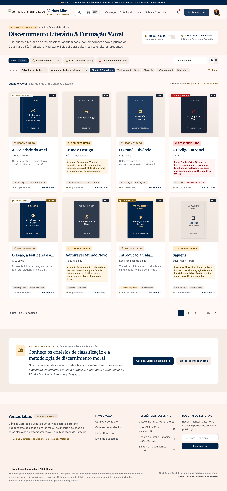
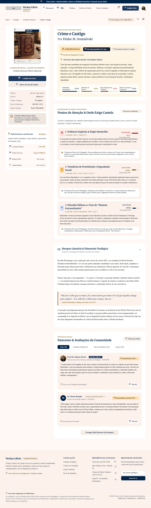
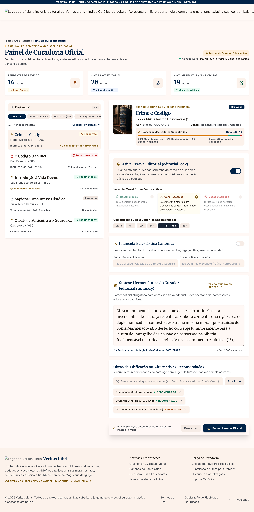

# Veritas Libris

Plataforma de **Curadoria e Discernimento Literário Católico** em monorepo TypeScript, dedicada à análise moral, doutrinária e estética de obras literárias à luz da Tradição e do Magistério Eclesial.

---

## Prévia Visual

| Catálogo & Descoberta | Ficha & Veredito Doutrinário | Painel de Curadoria Oficial |
| :---: | :---: | :---: |
|  |  |  |

---

## Documentação

| Documento | Conteúdo |
| :--- | :--- |
| **[Manual da Plataforma](docs/guia-veritas.md)** | Critérios, papéis (`READER`, `CURATOR`, `ADMIN`), curadoria, Copiloto IA e sugestões |
| **[Arquitetura do Sistema](docs/architecture.md)** | Camadas do monorepo, modelos Mongoose, motor de consenso, RBAC e deploy |
| **[Referência da API](docs/api.md)** | Endpoints `/api/v1`, autenticação, papéis exigidos e rate limits |
| **[Changelog](CHANGELOG.md)** | Histórico de versões (`v1.0.0` até `v1.5.1`) |

---

## Estrutura & Stack

```text
veritas-libris/
├── packages/shared/   # @app/shared — Schemas Zod (SSOT), enums doutrinários e utilitários
├── apps/api/          # @app/api    — Fastify 5, Mongoose/MongoDB, Firebase Admin e provedores externos
├── apps/web/          # @app/web    — React 19, Vite 8, Tailwind CSS v4, TanStack Query e Firebase Auth
└── docs/              # Documentação técnica e manual oficial
```

- **Backend:** Node.js `>= 20`, Fastify 5, `fastify-type-provider-zod`, Mongoose, Firebase Admin SDK, Google Books, BrasilAPI ISBN, Open Library e Magisterium AI.
- **Frontend:** React 19, Vite 8, Tailwind CSS v4, React Router v7, TanStack Query v5, Firebase Auth, Lucide React e Vitest.

---

## Principais Rotas (`@app/web`)

| Rota | Página | Acesso |
| :--- | :--- | :--- |
| `/` | Catálogo paginado com filtros e Modo Família | Público |
| `/livros/:id` | Ficha bibliográfica, dimensões, ressalvas e pareceres | Público |
| `/criterios`, `/sobre`, `/guia` | Metodologia editorial, missão e guia interativo | Público |
| `/sugestoes` | Indicação de obras (ISBN-13) e melhorias | Público |
| `/minha-lista`, `/meus-pareceres` | Lista pessoal e gestão dos próprios pareceres | Autenticado |
| `/curadoria` | Fila editorial, trava de 4 pontos, Copiloto IA e triagem | `CURATOR` / `ADMIN` |
| `/admin` | Gestão de usuários, papéis e `AuditLog` | `ADMIN` |

---

## Como Rodar Localmente

**Pré-requisitos:** Node.js `>= 20`, Docker (MongoDB) e projeto Firebase com login Google.

```bash
# 1. Instalar dependências
npm install

# 2. Subir MongoDB local
docker compose up -d

# 3. Configurar variáveis de ambiente
# Copie apps/api/.env.example -> apps/api/.env
# Copie apps/web/.env.example -> apps/web/.env

# 4. Iniciar API (porta 3333) e Web (porta 5173)
npm run dev --workspace=@app/api
npm run dev --workspace=@app/web
```

- **Backend (`apps/api/.env`):** obrigatórias `MONGODB_URI`, `FIREBASE_PROJECT_ID`, `FIREBASE_CLIENT_EMAIL` e `FIREBASE_PRIVATE_KEY`; opcionais `GOOGLE_BOOKS_API_KEY`, `MAGISTERIUM_API_KEY`, `ADMIN_EMAILS`, `CORS_ORIGIN`, `IMPORT_REQUIRES_AUTH` e `REVIEW_REQUIRES_AUTH` (veja detalhes em `apps/api/.env.example`).
- **Frontend (`apps/web/.env`):** `VITE_FIREBASE_*` e `VITE_API_URL` (vazio em dev para usar o proxy `/api -> http://localhost:3333`).

---

## Testes & Build

```bash
npm test --workspace=@app/shared
npm test --workspace=@app/api && npm run typecheck --workspace=@app/api
npm test --workspace=@app/web && npm run typecheck --workspace=@app/web && npm run build --workspace=@app/web
```

---

> **Nota Canônica:** As avaliações e classificações da **Veritas Libris** têm caráter pedagógico e consultivo de discernimento leigo, não substituindo o parecer oficial diocesano (*Nihil Obstat* / *Imprimatur*).
